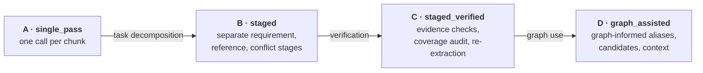
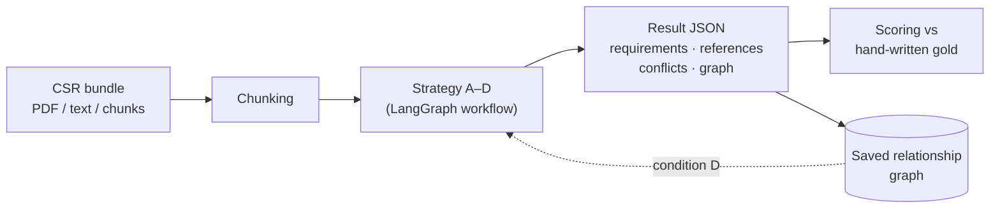

# CSR Lab

An experimentation framework for analysing **customer-specific requirement (CSR)** documents
with LLMs. It measures how much structured, multi-stage processing and a document-relationship
graph improve two tasks:

1. **Referenced-document extraction**: finding every document each requirement references.
2. **Potential conflict detection**: flagging requirements that may be incompatible, with
   evidence, for human review.

> **Research question.** To what extent do structured, multi-stage processing and document
> relationship tracking improve the completeness and accuracy of referenced-document extraction
> and potential conflict identification in CSR documents, compared with a single-pass LLM approach?

## Experimental design

Four conditions, each adding one capability to the last, so every adjacent pair isolates one effect.
All share the same chunks, model, settings and scoring; cost is reported next to accuracy.



| Condition | Adds | Effect isolated |
|---|---|---|
| A `single_pass` | One structured call returns requirements, references and conflicts | baseline |
| B `staged` | Separate extraction stages | decomposition |
| C `staged_verified` | Evidence validation, distractor checks, coverage audit, targeted re-extraction | verification |
| D `graph_assisted` | Graph-based alias resolution, known-document audit, conflict candidate selection | graph use |

A second family compares the common industry approach (model-made chunks, per-chunk extraction)
against the staged pipeline, isolating chunking, reference merging and PDF preprocessing.

## Pipeline



Every strategy emits the same validated JSON schema and is scored by the same code. Conflicts are
always *potential* conflicts marked for human review; the system never resolves them.

## Dataset

Synthetic CSR cases with hand-specified ground truth, also rendered as PDFs and pre-chunked files.

| Split | Cases | Requirements | References | Conflict pairs | Hard negatives |
|---|---|---|---|---|---|
| dev | 2 | 27 | 25 | 7 | 5 |
| heldout | 3 | 45 | 42 | 10 | 8 |

Cases cover aliases, revisions, tables, distractor numbers, unavailable documents, nested
references, exclusions and precedence clashes. Real CSRs (e.g. PURE) are analysed without scoring.

## Quick start

```bash
python3 -m venv .venv && source .venv/bin/activate
pip install -r requirements.lock && pip install -e . --no-deps
pytest
csr-lab experiment dev                  # offline, mock model
csr-lab experiment dev --llm lmstudio   # local model via LM Studio
```

| Command | Purpose |
|---|---|
| `csr-lab experiment NAME` | Run an experiment from `configs/experiments.yaml` |
| `csr-lab sweep NAME` | Run an experiment over a grid of settings |
| `csr-lab analyze FILES --strategy graph_assisted` | Analyse one document bundle |
| `csr-lab build-graph` | Build a relationship graph from PDFs in `input/` |
| `csr-lab evaluate result.json gold.json` | Score one result |
| `csr-lab llms` | List and select LLM profiles |

Results go to `outputs/<experiment-id>/` (`report.md`, metrics CSVs, every prediction) and to a
SQLite history.

## Limitations

- Mock-model results validate the machinery only; hypotheses need real models.
- The dataset is small, so per-case comparisons are descriptive, not significance tests.
- No OCR; department assignment is not yet implemented.

## Documentation

- [Usage reference](docs/usage.md): commands, LLM setup, sweeps, saved graph
- [Experiment design](docs/experiment_design.md): metrics, matching rules, statistics
- [Architecture](docs/architecture.md): code layout and workflow diagrams
- [Output schema](docs/output_schema.md) · [Data](data/README.md)
